<!-- ANIMATED TERMINAL BANNER -->
<picture>
  <source media="(prefers-color-scheme: dark)" srcset="https://raw.githubusercontent.com/UnnamedPeople-Chin/UnnamedPeople-Chin/main/dark.svg?v=15&cache=bust">
  <source media="(prefers-color-scheme: light)" srcset="https://raw.githubusercontent.com/UnnamedPeople-Chin/UnnamedPeople-Chin/main/light.svg?v=15&cache=bust">
  
</picture>

 
 

<!-- GITHUB STATS & STREAK CARDS -->

  
   
   
  <!-- Instance Vercel Pribadi UnnamedPeople-Chin -->
  
  

 
 

<!-- CONTRIBUTION BOMBERMAN ANIMATION -->

  <picture>
    <source media="(prefers-color-scheme: dark)" srcset="https://raw.githubusercontent.com/UnnamedPeople-Chin/UnnamedPeople-Chin/output/bomberman-contribution-graph-dark.svg?v=3" />
    <source media="(prefers-color-scheme: light)" srcset="https://raw.githubusercontent.com/UnnamedPeople-Chin/UnnamedPeople-Chin/output/bomberman-contribution-graph.svg?v=3" />
    
  </picture>

 
 

<!-- FEATURED PROJECTS GRID -->

  <picture>
    <source media="(prefers-color-scheme: dark)" srcset="./projects.svg?v=7" />
    <source media="(prefers-color-scheme: light)" srcset="./projects-light.svg?v=7" />
    
  </picture>
   
   
  
  &nbsp;
  
  &nbsp;
  
  &nbsp;
  
   
   
  
  &nbsp;
  
  &nbsp;
  
  &nbsp;
  
   
   
  Live Demos: <a href="https://unnamedpeople-chin.github.io/AetherCast/" target="_blank">AetherCast Web</a> | <a href="https://unnamedpeople-chin.github.io/SignFlow/" target="_blank">SignFlow Studio</a> | <a href="https://qristrack.biz.id/?demo=1" target="_blank">QRIS-Track Sandbox</a>

 
 

<!-- SOCIAL & CONTACT BADGES -->

  
  &nbsp;&nbsp;
  
  &nbsp;&nbsp;
  
  &nbsp;&nbsp;
  

